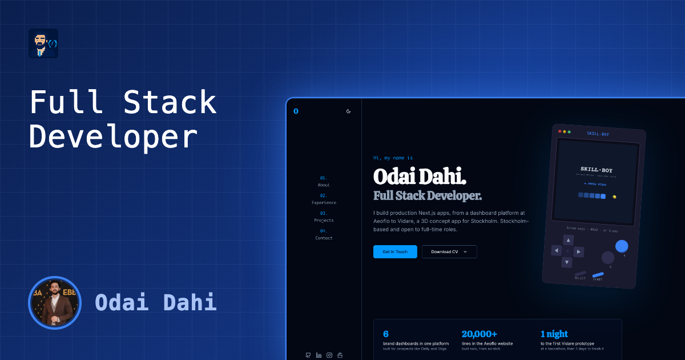

# Odai Dahi — Full Stack Developer Portfolio



Live at **[www.odaidh.dev](https://www.odaidh.dev)**

## ✨ Features

- 🌓 Dark-first design with a light-mode toggle
- 🎮 **Skill·Boy** — a hidden Game Boy–style Snake game where eating skills levels up your developer title
- 🤖 **AI chat assistant** — ask about Odai's work (Groq-powered, rate-limited, 5 questions/day)
- 📝 Markdown-driven content — one file (`src/content/portfolio.md`) powers the whole site
- 🖼️ Project pages with live website previews (sandboxed iframes with screenshot fallback)
- 📫 Contact form with validation (React Hook Form + Zod) and email delivery via Resend
- 📄 Multilingual CV download (English & Swedish)
- 🔍 Deep SEO: Person JSON-LD, dynamic sitemap & robots, Open Graph/Twitter cards, `llms.txt` for AI agents, IndexNow submission
- 🧩 One source of facts: the chat assistant's knowledge, `/llms.txt` and the JSON-LD are all generated from `portfolio.md`
- ✅ Tested: unit tests keep the content, CV and email signature consistent; Playwright checks every page type, accessibility (WCAG 2.1 AA) and the no-JavaScript view; CI runs it all on every push
- ⚡ Statically generated project pages, scroll-progress bar, section-aware navigation

## 🛠️ Tech Stack

| Concern | Choice |
|---|---|
| Framework | **Next.js 16** (App Router) |
| Language | TypeScript |
| Styling | Tailwind CSS + shadcn/ui (Radix) |
| Icons | lucide-react |
| Content | Markdown + front-matter (`gray-matter`, `remark`) |
| Forms | React Hook Form + Zod |
| Email | Resend |
| AI chat | Groq SDK + Upstash Redis (rate limiting) |
| Deployment | **Netlify** (`@netlify/plugin-nextjs`) |

## 🚀 Getting Started

### Prerequisites

- Node.js 18+
- npm

### Installation

1. Clone the repository:

```bash
git clone https://github.com/odai-dh/portfolio.git
cd portfolio
```

2. Install dependencies:

```bash
npm install
```

3. Create a `.env.local` file:

```bash
RESEND_API_KEY=...            # contact form email delivery
GROQ_API_KEY=...              # AI chat assistant
UPSTASH_REDIS_REST_URL=...    # chat rate limiting
UPSTASH_REDIS_REST_TOKEN=...  # chat rate limiting
```

4. Run the development server:

```bash
npm run dev
```

5. Open http://localhost:3000

## 📜 Scripts

| Script | What it does |
|---|---|
| `npm run dev` | Development server |
| `npm run build` | Production build |
| `npm run start` | Serve the production build |
| `npm run lint` | Lint |
| `npm run typecheck` | TypeScript check (`tsc --noEmit`) — also runs in the Netlify build |
| `npm run test` | Unit tests (Vitest): content, generated facts, CV and signature consistency |
| `npm run test:e2e` | Browser tests (Playwright + axe) against the production build |
| `npm run check` | Types, lint, unit tests, build and browser tests in one go (what CI runs) |
| `npm run cv` | Rebuild the CV PDFs from `docs/cv/*.json` |
| `npm run indexnow` | Submit the live sitemap's URLs to IndexNow (run after deploy) |

## 🔧 Customization

All content lives in **`src/content/portfolio.md`**: the YAML front-matter defines `name`, `title`, `subtitle`, `email`, `socials`, `experience[]`, and `projects[]` (with tags, links, optional Figma link, and per-project Markdown content); the Markdown body below the front-matter is the About section. Edit that one file to change the site.

Theme colors are HSL CSS variables in `src/app/globals.css`; Tailwind config in `tailwind.config.ts`.

## 📁 Project Structure

```
portfolio/
├── public/                    # static assets, SEO verification files, CVs
├── scripts/indexnow.mjs       # IndexNow submission
├── src/
│   ├── app/
│   │   ├── layout.tsx         # metadata, JSON-LD, providers
│   │   ├── page.tsx           # home page
│   │   ├── actions.ts         # contact form server action
│   │   ├── robots.ts          # dynamic robots.txt
│   │   ├── sitemap.ts         # dynamic sitemap.xml
│   │   ├── api/chat/route.ts  # AI chat endpoint
│   │   └── projects/[slug]/   # project detail pages (SSG)
│   ├── components/            # sections, Snake game, chat widget, ui/ (shadcn)
│   ├── content/portfolio.md   # ★ all site content
│   ├── hooks/
│   └── lib/markdown.ts        # content parser
├── netlify.toml               # deploy config (typecheck + build)
└── tailwind.config.ts
```

---

Designed and developed by [Odai Dahi](https://github.com/odai-dh)
